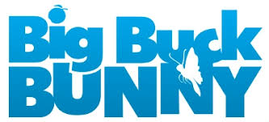
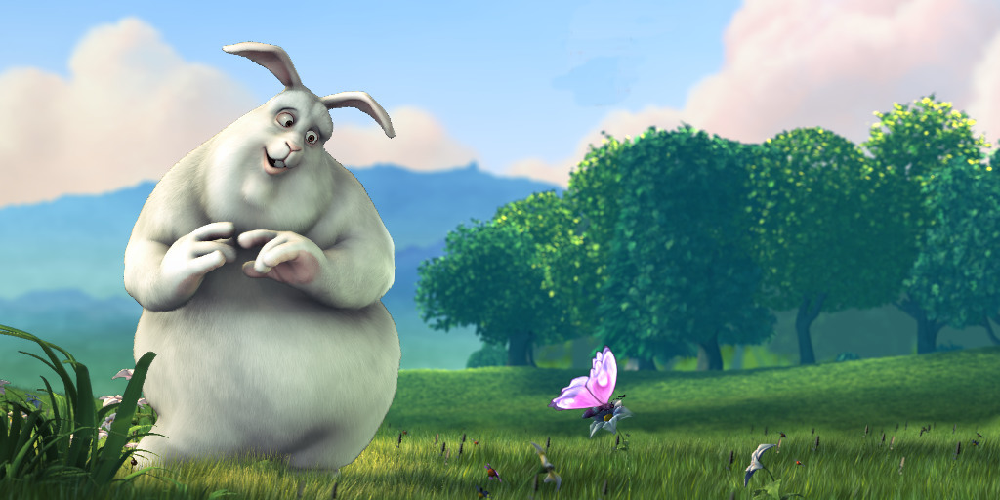
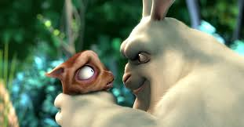

# Практика 1. Вёрстка страницы по БЭМ

Страница про мультфильм Big Buck Bunny по макету `img/maket.jpg`.

Как открыть: открыть файл `index.html` в браузере.

## Что такое БЭМ в двух словах

Имена классов строятся по схеме:

- `block` — самостоятельный кусок страницы (шапка, меню, карточка);
- `block__element` — часть блока, без блока не живёт (пункт меню, картинка карточки);
- `block__element--modifier` — вариант элемента (активный пункт меню).

## Файлы

| Файл | За что отвечает |
|---|---|
| `index.html` | разметка страницы |
| `style.css` | все стили |
| `img/` | картинки из задания и макет |

## index.html по кускам

```html
<!DOCTYPE html>
<html lang="ru">
```
Говорит браузеру, что это HTML5 и страница на русском.

```html
<meta charset="UTF-8">
<meta name="viewport" content="width=device-width, initial-scale=1.0">
<title>Big Buck Bunny</title>
```
Кодировка (чтобы русские буквы не ломались), правильный масштаб на телефоне, название вкладки.

```html
<link href="https://fonts.googleapis.com/css2?family=Roboto+Condensed...">
<link rel="stylesheet" href="style.css">
```
Подключает узкий шрифт Roboto Condensed для заголовков и наш файл стилей.

```html
<body class="page">
```
Блок `page` — вся страница. На него вешается фон с кляксой.

```html
<header class="header">
  <div class="header__inner">
```
Блок `header` — шапка. `header__inner` держит содержимое шапки по центру шириной 940px.

```html
<a class="header__logo" href="#">
  
</a>
```
Логотип слева, кликабельный.

```html
<div class="header__side">
```
Правая часть шапки: поиск сверху, меню снизу.

```html
<form class="search" action="#">
  <input class="search__input" type="text" placeholder="Поиск по сайту...">
  <button class="search__button" type="submit">OK</button>
</form>
```
Блок `search` — поле поиска и круглая кнопка «OK».

```html
<nav class="menu">
  <ul class="menu__list">
    <li class="menu__item"><a class="menu__link" href="#">Главная</a></li>
    <li class="menu__item"><a class="menu__link menu__link--active" href="#">О мультфильме</a></li>
    ...
```
Блок `menu` — навигация. `menu__link--active` это модификатор: подчёркивает текущий пункт «О мультфильме».

```html
<main class="main">
```
Основная часть страницы между шапкой и подвалом.

```html
<section class="promo">
  <div class="promo__frame">
    
    <button class="promo__play" type="button" aria-label="Смотреть"></button>
  </div>
  <h1 class="promo__title">Действующие лица: ...</h1>
</section>
```
Блок `promo` — большая картинка в белой рамке, кнопка «плей» поверх неё и главный заголовок под ней.

```html
<section class="cards">
  <article class="card">
    <div class="card__frame">
      
    </div>
    <h2 class="card__title">Кролик Bunny</h2>
    <h3 class="card__subtitle">О кролике</h3>
    <p class="card__text">Работы начались ...</p>
    <a class="card__more" href="#">Подробнее</a>
  </article>
  ...
```
Блок `cards` — ряд из трёх карточек. Каждая `card` это картинка в рамке, заголовок, синий подзаголовок, текст и ссылка «Подробнее». Карточки одинаковые по структуре, меняются только текст и картинка. Это и есть переиспользование блока.

```html
<footer class="footer">
  <div class="footer__inner">
    <div class="footer__column">
      <h4 class="footer__title">Файлы</h4>
      <ul class="footer__list">
        <li><a class="footer__link" href="#">Модели</a></li>
```
Блок `footer` — тёмный подвал из четырёх колонок: «Файлы», «Архивы», «Категории», «Последние записи». В каждой колонке заголовок и список ссылок.

## style.css по кускам

```css
* {
  box-sizing: border-box;
}
```
Ширина элемента считается вместе с отступами и рамкой. Так проще считать размеры.

```css
.page {
  background: #f7f6ea url('img/klyaksa.jpg') no-repeat center top;
  background-blend-mode: multiply;
}
```
Кремовый фон страницы и голубая клякса сверху. `multiply` убирает белый фон у картинки кляксы, остаётся только сама клякса.

```css
.header__inner,
.main,
.footer__inner {
  width: 940px;
  margin: 0 auto;
}
```
Шапка, контент и подвал одной ширины и стоят по центру.

```css
.header__inner {
  display: flex;
  justify-content: space-between;
}
```
Логотип прижат влево, поиск с меню вправо.

```css
.header__logo-image {
  mix-blend-mode: multiply;
}
```
Убирает белый прямоугольник вокруг логотипа.

```css
.header__side {
  display: flex;
  flex-direction: column;
  align-items: flex-end;
}
```
Поиск и меню стоят друг под другом и прижаты вправо.

```css
.search__input { ... border-radius: 16px; ... }
.search__button { position: absolute; right: 0; border-radius: 50%; ... }
```
Поле поиска с закруглёнными краями. Кнопка «OK» круглая и наложена на правый край поля.

```css
.menu__list {
  display: flex;
  list-style: none;
}
```
Пункты меню в одну строку, без точек списка.

```css
.menu__item + .menu__item::before {
  content: '';
  width: 2px;
  height: 14px;
  margin: 0 15px;
  background: #6b6159;
}
```
Рисует вертикальную черту между пунктами меню. Перед первым пунктом черты нет.

```css
.menu__link { ... text-transform: uppercase; ... }
.menu__link:hover,
.menu__link--active {
  text-decoration: underline;
}
```
Пункты меню большими буквами. Активный пункт и пункт под мышкой подчёркнуты.

```css
.promo__frame {
  position: relative;
  padding: 5px;
  border: 1px solid #d9dccf;
  background: #fff;
  box-shadow: ...;
}
```
Белая рамка с тенью вокруг большой картинки. `relative` нужен, чтобы кнопку «плей» можно было поставить поверх.

```css
.promo__image {
  height: 390px;
  object-fit: cover;
}
```
Картинка заполняет рамку и обрезается по краям без искажения.

```css
.promo__play { position: absolute; top: 50%; left: 50%; ... border-radius: 50%; }
.promo__play::after { border-left: 56px solid ...; border-top/bottom: transparent; }
```
Полупрозрачный круг по центру картинки. Внутри него треугольник «плей», нарисованный рамками.

```css
.promo__title { text-align: center; text-transform: uppercase; }
```
Заголовок «Действующие лица» по центру, большими буквами.

```css
.cards {
  display: flex;
  justify-content: space-between;
}
.card {
  width: 300px;
}
```
Три карточки по 300px в ряд с равными промежутками.

```css
.card__frame { ... }
.card__image { height: 122px; object-fit: cover; }
```
Картинка карточки в такой же белой рамке, как большая.

```css
.card__title { font-size: 36px; ... }
.card__subtitle { color: #0b8bc6; border-bottom: 3px solid #8c8580; ... }
.card__text { color: #8a827b; ... }
```
Крупный заголовок, синий подзаголовок с серой линией снизу, серый текст.

```css
.card__more { color: #f58220; ... }
.card__more::after {
  border-radius: 50%;
  background: #f58220 url('img/arrow-right.png') no-repeat center / 14px;
}
```
Оранжевая ссылка «Подробнее» и оранжевый кружок со стрелкой после неё.

```css
.footer {
  background: #4f4b47;
}
.footer__inner {
  display: flex;
}
```
Тёмный подвал, колонки в ряд.

```css
.footer__column {
  width: 25%;
  border-left: 1px solid #5f5a55;
}
.footer__column:first-child {
  border-left: none;
}
```
Четыре колонки одинаковой ширины с тонкой линией между ними. У первой колонки линии нет.

```css
.footer__title { color: #fff; text-transform: uppercase; ... }
.footer__link { color: #b4aea8; }
.footer__link:hover { color: #fff; }
```
Белые заголовки колонок, светло-серые ссылки, при наведении ссылка белеет.
